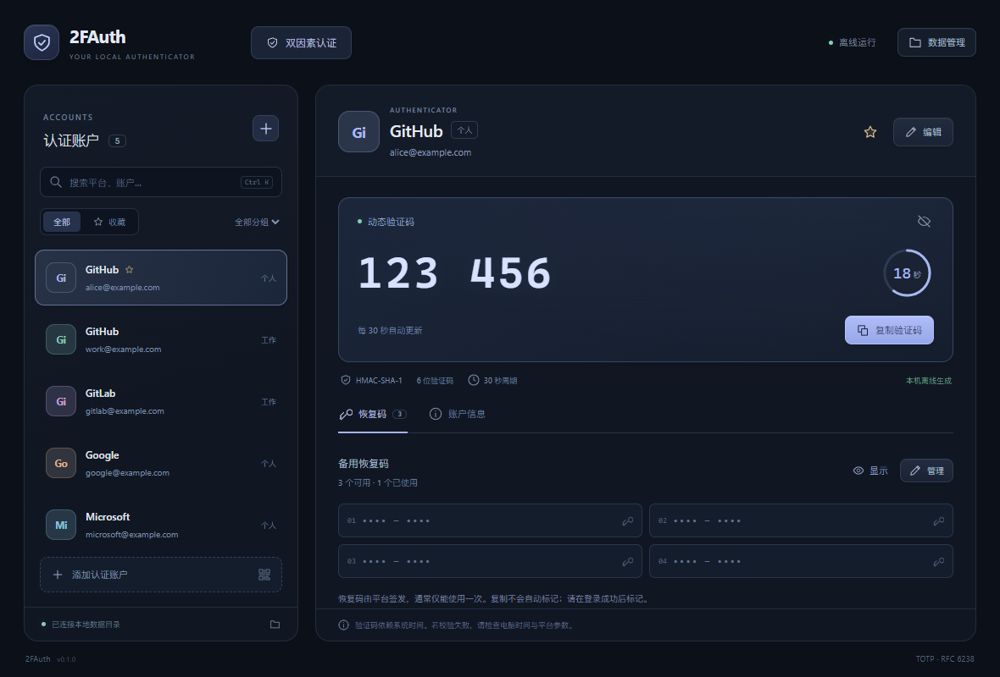
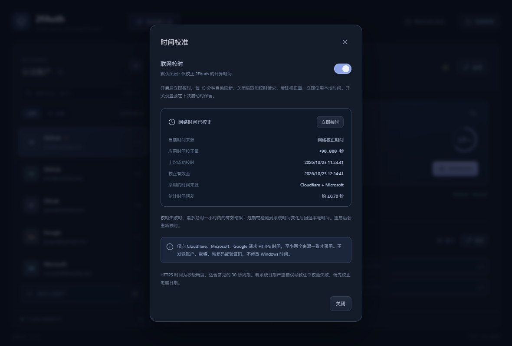

# 2FAuth

与 APIConfig / DeskFinger 风格一致的本地 TOTP 认证器，使用 React、TypeScript、Tauri 2 和 Rust。可用于 GitHub 等支持标准 TOTP 的服务；无账号注册、无云端同步，验证码在本机生成。

## 使用

1. 启动应用，选择空目录以初始化，或连接包含 `accounts.json` 的已有 2FAuth 目录。
2. 在目标平台开启双因素认证，选择认证器方式，获取共享密钥或二维码。
3. 点击“添加账户”：手动输入 Base32 密钥，粘贴 `otpauth://totp/…` 链接，或选择、拖入、粘贴二维码图片。核对平台、用户名和参数后保存。
4. 复制验证码，在平台完成绑定。每个账户可独立配置 SHA-1 / SHA-256 / SHA-512、6 / 7 / 8 位数字和 1–300 秒周期；预设使用常见的 SHA-1、6 位、30 秒，具体以平台提供的参数为准。
5. 保存平台提供的恢复码，每行一条。恢复码不会由本工具生成；使用成功后点击该条右侧的方框标记“已使用”。复制本身不会改变状态。

左侧支持平台 / 账户搜索、分组筛选与收藏优先排序，`Ctrl+K` 聚焦搜索。右侧显示当前验证码、倒计时、算法参数、恢复码及账户信息。复制时重新计算当前验证码；恢复码和密钥默认隐藏，切换账户或窗口失焦时隐藏已显示内容。编辑账户时密钥留空可保留原值。



## 可选联网校时

点击顶部“时间校准”可开启联网校时，**默认关闭**。关闭时使用本机系统时间且不发起校时请求；开启后立即校时，并每 15 分钟刷新，也可点击“立即校时”。开关保存在应用配置目录的 `time-settings.json` 中，下次启动沿用设置；校正结果仅在内存中保留，重启后重新获取。

- 校时仅影响 2FAuth 的验证码、倒计时与复制时的有效期检查，不修改 Windows 时间，不需要管理员权限。
- 通过 HTTPS 请求 Cloudflare、Microsoft、Google 的响应时间，只读取响应头，不发送账户、共享密钥、恢复码或验证码。至少两个来源的估算偏差在 2 秒内一致才采用，并显示采用来源与估计误差。
- 校验 HTTPS 证书、拒绝过期缓存、超过 3 秒的响应和校时期间的系统时间跳变。HTTP 时间为秒级精度，适合常见的 30 秒认证周期，不提供精密授时保证。
- 网络失败后每分钟重试，继续使用上次成功后一小时内仍有效的结果；没有有效结果时回退本地时间，并显示原因。结果过期或检测到系统时间跳变 / 休眠异常时停用旧校正并重新校时。
- 关闭开关会取消尚未完成的请求、清除时间校正并立即切回本地时间；迟到的响应不会重新启用校正。
- 若电脑日期严重错误导致 HTTPS 证书验证失败，需要先校正系统日期。应用不会绕过证书校验。



## 本地数据

```text
<用户选择的数据目录>/
  accounts.json           # 账户、密钥、算法参数、分组、备注、恢复码与使用状态
  accounts.previous.json  # 每次成功写入前的上一版本
  .2fauth.lock            # 防止多个应用窗口同时写入该目录
```

应用配置目录中的 `storage.json` 只保存数据目录指针（Windows 通常在 `%APPDATA%/com.desktoolkit.twofauth/`）。账户密钥不会进入浏览器 localStorage；普通账户列表只返回摘要，密钥和恢复码仅在显式查看或编辑时提供给界面。

**此版本使用明文 JSON，没有主密码或磁盘加密。** 应将数据目录和导出备份放在可信的位置。显隐按钮仅遮挡界面内容，不提供加密保护。剪贴板由操作系统管理，复制后不会自动清空。

“数据管理”支持打开目录、切换 / 重新连接目录、导出备份及合并导入。切换目录不会复制当前数据；导出文件名必须独立且尚不存在。迁移到另一目录时，可先导出，再连接新目录并导入。

- 导入前校验整个文件；不支持的版本或损坏文件不会替换当前账户。
- 同 ID 或相同密钥与算法参数的账户视为重复并跳过，已有账户与恢复码使用状态优先。
- 写入采用同目录临时文件、同步到磁盘后原子替换，并保留上一版本；保存失败不更新内存状态。
- 原目录丢失或损坏时显示错误，不会静默初始化空账户库。外部编辑后需在“数据管理”重新连接目录；检测到外部修改时拒绝覆盖。
- 恢复上一版本：先保留损坏文件，连接一个新的空目录，再导入原目录的 `accounts.previous.json`。旧备份中的恢复码状态可能较旧，需要与实际使用情况核对。
- 删除账户只影响本地数据，不会关闭平台上的双因素认证。上一版本或手动备份仍可能保留该账户。

数据格式版本为 1，带 `format: "2FAuth"` 和 `version: 1` 标识。最多 2000 个账户，每个账户最多 200 条恢复码，数据文件最大 16 MB。仅支持标准 TOTP，不支持 HOTP、Steam 特殊编码、Google Authenticator 批量迁移二维码或摄像头扫码。二维码图片在本地解析，支持 PNG / JPG / WebP。

## 开发与构建

需要 Node.js、pnpm、Rust MSVC 工具链、Visual Studio C++ 构建工具和 WebView2 Runtime。

```sh
pnpm install
pnpm tauri dev
```

固定开发端口为 **1432**，不会占用 1420、APIConfig 的 1430 或 DeskFinger 的 1431。`pnpm dev` 可单独查看前端，但本地文件和认证功能需要 Tauri 后端。

```sh
pnpm tauri build
```

Windows 构建结果：

- `src-tauri/target/release/twofauth.exe`：可直接运行的应用（需要 WebView2 Runtime）。
- `src-tauri/target/release/bundle/nsis/2FAuth_0.1.0_x64-setup.exe`：NSIS 安装程序。

PowerShell 若限制 `.ps1`，使用 `pnpm.cmd tauri build`，对应同一 pnpm 构建命令。图标源文件为 `app-icon.svg`，运行 `pnpm tauri icon app-icon.svg` 可重新生成平台图标。

## 验证

```sh
pnpm test
cd src-tauri
cargo test --lib
cargo fmt --check
```

Rust 测试覆盖 RFC 6238 的全部 18 个 SHA-1 / SHA-256 / SHA-512 标准向量，以及时间边界、前导零、URI / Base32 校验、真实文件持久化、备份合并、目录锁、损坏文件和外部修改保护。校时测试覆盖默认关闭、设置持久化、来源一致性、缓存 / 延迟拒绝、失败保留、结果过期、系统时间变化、请求取消与迟到响应。Playwright 使用 Edge，通过模拟 Tauri IPC 检查账户、恢复码、导入、数据目录，以及正负时间偏差下的倒计时、复制和校时开关交互；不连接真实平台、不使用真实密钥。

真实 HTTPS 校时检查为显式运行的测试：在 `src-tauri` 目录执行 `cargo test --lib time_sync::tests::live_https_sources -- --ignored --nocapture`。常规测试与 CI 不依赖外部时间服务。

Windows 构建后可运行 `powershell -NoProfile -ExecutionPolicy Bypass -File scripts/native-smoke.ps1`，通过 UI Automation 检查实际 exe、打包的前端、Rust 初始化命令和时间校准面板；检查不修改校时设置、不创建账户库或修改剪贴板。该脚本使用带 BOM 的 UTF-8，兼容 Windows PowerShell 5.1 的中文解析。

算法规范：[RFC 6238](https://www.rfc-editor.org/rfc/rfc6238)。认证链接格式：[Google Authenticator Key URI Format](https://github.com/google/google-authenticator/wiki/Key-Uri-Format)。HTTPS 时间响应参考 [RFC 9110 Date](https://www.rfc-editor.org/rfc/rfc9110.html#name-date)。HMAC 与 SHA 实现使用 RustCrypto 库。
