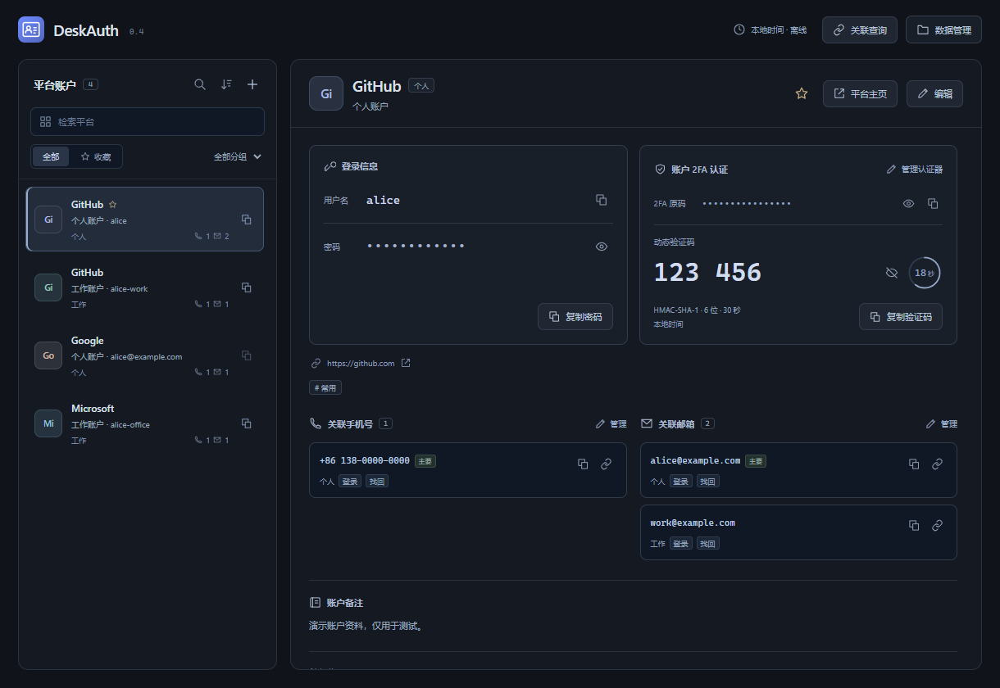
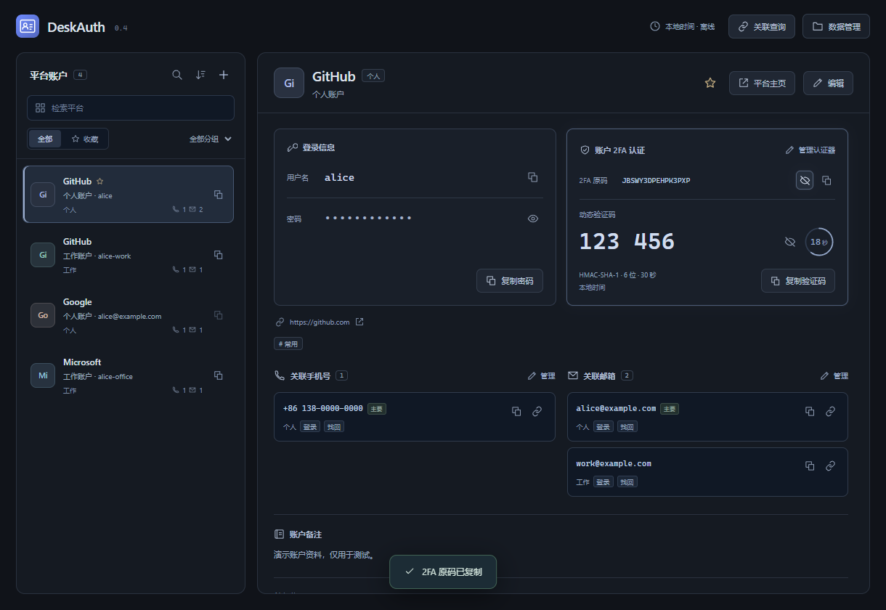
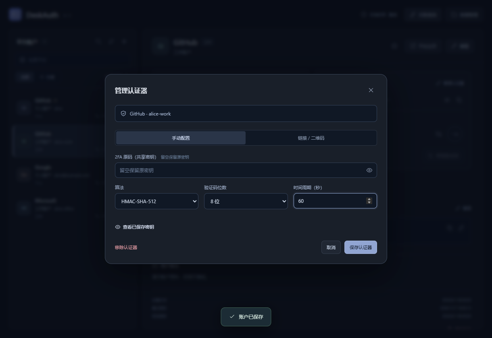
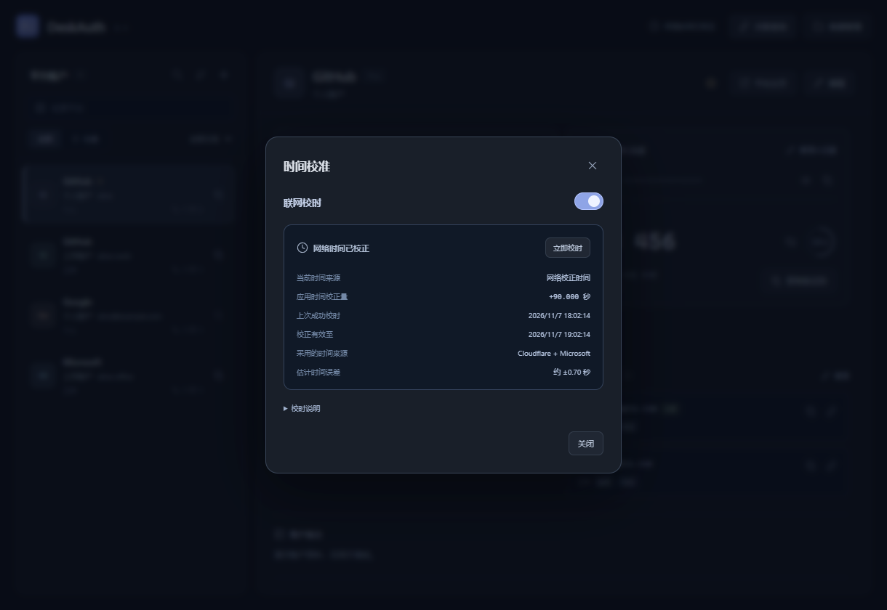
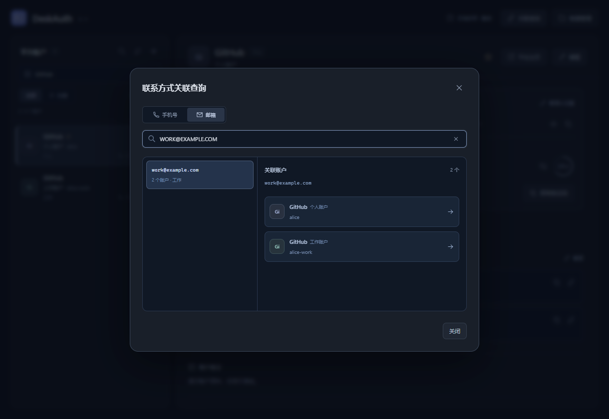

# DeskAuth

与 2FAuth、APIConfig 保持一致的本地账户资料管理工具，采用 React、TypeScript、Tauri 2 和 Rust。记录各个平台的用户名、密码、TOTP 认证器，以及关联的多个手机号、邮箱；数据以可读的明文 JSON 保存。



## 使用

1. 启动应用，点击“选择数据目录”。可初始化空目录，或连接已有的 DeskAuth 目录。
2. 点击“添加账户”，填写平台、用户名，可补充平台主页、账户别名、密码、分组、标签和备注。
3. 按需添加多个手机号、邮箱，分别设置标签、登录 / 验证 / 找回 / 联系用途及备注。同类联系方式最多设置一个主要项。
4. 在账户列表右侧点击复制图标，或在详情页点击“复制密码”。复制直接读取本地记录，无需先显示密码；用户名、手机号和邮箱也可单独复制。
5. 在详情页点击“配置认证器”，关联此账户的 TOTP 密钥。配置后可在账户详情查看和复制 2FA 原码（Base32 密钥）与动态验证码。
6. 点击详情顶部“平台主页”，使用系统浏览器打开配置的网址。

左侧标题栏提供搜索、排序和添加按钮；账户搜索支持 `Ctrl+K` 展开、`Esc` 收起，收起时清除搜索条件。平台检索始终保留，可组合分组、收藏筛选；支持名称升降序、用户名、最近更新、最近添加和收藏优先排序，切换排序保留当前选中账户。列表占用侧栏剩余空间并独立滚动。

界面采用低饱和深灰蓝配色，统一登录、2FA 与联系方式卡片的边框、留白和按钮；悬停时显示轻微的方框光晕，设置说明可按需展开。图标沿用工具组的渐变底色与白色线条。

同一平台支持多个账户。平台、主页、用户名和别名全部相同的记录会被视为重复；可以通过别名区分同名的个人、工作账户。密码可暂时留空，登录标识可填写用户名、邮箱或手机号。

密码默认遮挡，点击眼睛图标查看；切换账户、更新记录或窗口失焦后收起。编辑时默认保留原密码，可以明确选择更换或清空；新密码按原文保存，包括首尾空格。剪贴板由系统管理，本版本不自动清空。

## 账户 2FA 认证

每个账户可配置一个标准 TOTP 认证器，密钥与算法参数保存在该账户的 JSON 文件中，使用 RFC 6238 算法生成动态验证码。支持 HMAC-SHA-1 / SHA-256 / SHA-512、6 / 7 / 8 位验证码及 1–300 秒周期，默认 SHA-1、6 位、30 秒。不支持 HOTP、短信收码或推送认证，不记录恢复码。

- **手动配置**：输入 Base32 密钥并选择参数。修改已有认证器时，密钥留空会保留原值；普通账户编辑也会保留认证器。
- **链接 / 二维码**：解析 `otpauth://totp/` 链接，或选择、拖入、粘贴二维码图片，在本机解码。解析后显示来源平台和账户，需核对并保存；不会改写当前账户的平台与用户名。
- **原码与验证码**：原码默认遮挡，可单独显示或复制；窗口失焦、切换账户后收起。动态验证码自动更新、显示倒计时，支持遮挡和快速复制。复制时重新获取验证码并检查时间来源及有效期；读取失败或过期时不显示可复制的旧码。
- **移除**：只移除 DeskAuth 中的认证器配置，保留账户密码和联系方式；不改变平台上的双因素认证设置。





## 可选联网校时

顶部“时间校准”默认使用本地时间，联网校时默认关闭。开启后向 Cloudflare、Microsoft、Google 请求 HTTPS 时间，至少两个来源一致才采用；只调整 DeskAuth 计算验证码时使用的时间，不修改 Windows 时间，不发送账户、密码、密钥或验证码。

开启后立即校时，每 15 分钟刷新，失败后一分钟重试。失败时最多沿用一小时内的有效结果；结果过期或检测到系统时间变化时回退本地时间。关闭会取消请求、清除校正量并立即使用本地时间。开关会保留，重启后重新校时。面板可查看时间来源、偏差、误差、有效期并手动刷新。

HTTPS 时间精度为秒级，适合常见的 30 秒周期；系统日期严重错误可能使证书校验失败，需要先校正电脑日期。



## 检索与关联查询

- “搜索账户”检索平台、用户名、别名、网站、联系方式、分组、标签和备注；多个空格分隔的关键词需同时匹配，不检索密码。`Ctrl+K` 聚焦此框。
- 下方独立的“检索平台”输入框可按平台名称或网站地址筛选，与关键词、分组和收藏组合使用。
- 顶部“关联查询”按手机号 / 邮箱查看关联账户，点击结果跳转并重置旧筛选。也可直接点击详情页联系方式旁的关联图标。
- 号码匹配忽略 `+`、空格、括号、连字符和点；不推测国家区号。邮箱匹配忽略大小写。联系方式按原文展示，各账户中的用途和备注独立管理。



## 本地数据管理

采用一账户一文件的数据协议，不维护聚合账户库或额外的账户索引：

```text
<用户选择的数据目录>/
  deskauth.json           # 目录标记，不包含账户资料
  accounts/
    <账户 ID>.json        # 该账户的全部资料与 TOTP 配置
  history/
    <账户 ID>.json        # 该账户上一次修改或删除前的记录
  .deskauth.lock          # 数据目录写入锁
```

目录标记只有 `{ "format": "DeskAuth", "storage": "account-files" }`。账户文件统一使用 `{ "format": "DeskAuthAccount", "account": { ... } }`，包含平台、平台主页、用户名、明文密码、多项手机与邮箱、TOTP 原码及算法参数、分组、标签和时间信息。验证码和倒计时按需计算，不写入文件。可参考[完整账户 JSON 示例](docs/account.example.json)，其中全部资料为虚构。

账户 ID 为 UUID，文件名必须与 `account.id` 相同。改平台名称或用户名时文件名保持稳定。应用启动与重新连接时扫描 `accounts/*.json`，按字段建立内存检索。单个账户无需依赖其他账户文件；手动整理文件时请保留 ID 与文件名的对应关系。

- 应用只支持这一套文件协议，不包含旧版聚合文件的读取、迁移或其他工具的数据导入。已有开发版聚合文件会保留原样，请为当前版本选择新的空目录。
- 创建或修改只写入对应账户 JSON。保存采用同目录临时文件、同步到磁盘后原子替换；保存失败不更新内存记录，也不改写其他账户文件。
- 每次修改前将该账户原文件保存到 `history/<id>.json`；删除前同样先保存历史，再移除对应账户文件。历史文件与账户使用同一协议，不参与正常账户扫描。
- 多个窗口不能同时写同一目录。检测到外部新增、修改或删除账户文件时拒绝覆盖；手动编辑后需重新连接目录。损坏文件或文件名与 ID 不符会报告错误，原文件保留。
- 目录丢失或标记不可用时显示错误，不会静默创建空库。
- 每个账户最多 50 个手机号、50 个邮箱、20 个标签；最多 5000 个账户，单文件最大 512 KB，全部账户合计最大 128 MB。平台主页仅支持无内嵌凭据的 HTTP / HTTPS 地址。

### 备份与恢复

“导出备份”选择数据目录以外的保存位置，应用新建带时间和随机标识的备份文件夹，按同一结构保存 `deskauth.json` 与当前全部 `accounts/*.json`，不覆盖已有目录。备份不包含历史记录；需要历史时可以直接复制整个数据目录。

“导入备份”选择含有 `deskauth.json` 的备份目录，确认后合并新账户；全部文件先校验，已有 ID 或同平台 / 主页 / 用户名 / 别名的账户跳过，已有资料、密码与 TOTP 配置优先。重复导入不会重复创建账户。也可以直接将备份目录作为数据目录连接。

恢复某个账户时，先保留当前文件，再将 `history/<id>.json` 或备份中的对应文件复制到 `accounts/<id>.json`，然后重新连接。删除、清空或替换密码与密钥后，历史文件及手动备份可能仍保留原资料。

应用配置目录的 `storage.json` 仅保存 `dataDir` 指针，`time-settings.json` 仅保存联网校时开关，Windows 通常位于 `%APPDATA%/com.desktoolkit.deskauth/`。密码与 TOTP 密钥不写入浏览器 localStorage；账户列表 IPC 仅返回是否有密码及认证器参数，显式查看时才提供已保存的密码或密钥。密码和原码快速复制由 Rust 后端直接写入系统剪贴板。

按设计采用明文存储，无主密码或磁盘加密。联网校时关闭时不发起校时请求，打开平台主页时调用系统浏览器。

## 开发与构建

需要 Node.js、pnpm、Rust MSVC 工具链、Visual Studio C++ 构建工具和 WebView2 Runtime。

```sh
pnpm install --frozen-lockfile
pnpm tauri dev
pnpm tauri build
```

PowerShell 如限制 `.ps1`，使用 `pnpm.cmd tauri build`，调用的是同一 pnpm 构建命令。`pnpm dev` 仅启动前端，本地文件和密码操作需要 Tauri 后端。

项目开发端口配置如下，DeskAuth 固定使用 **1433**，端口冲突时直接报错，不自动改用其他端口。

| 项目 | 端口 |
|---|---:|
| APIConfig | 1430 |
| DeskFinger | 1431 |
| 2FAuth | 1432 |
| DeskAuth | 1433 |
| DeskTodo | 1442 |

DeskAuth 不使用用户指定排除的 1427，也不使用 1420。

Windows 构建产物：

- `src-tauri/target/release/deskauth.exe`：直接运行的程序，需要 WebView2 Runtime。
- `src-tauri/target/release/bundle/nsis/DeskAuth_0.4.0_x64-setup.exe`：NSIS 安装包。

图标源文件为 `app-icon.svg`，前端使用相同的 `public/app-icon.svg`；修改时需同步两处 SVG，可用 `pnpm tauri icon app-icon.svg` 重新生成平台资源。

## 验证

```sh
pnpm build
pnpm test
cargo fmt --manifest-path src-tauri/Cargo.toml --check
cargo test --manifest-path src-tauri/Cargo.toml --locked --lib
cargo clippy --manifest-path src-tauri/Cargo.toml --locked --lib --tests -- -D warnings
powershell -NoProfile -ExecutionPolicy Bypass -File scripts/native-smoke.ps1
```

Rust 测试使用真实临时目录，覆盖持久化、密码原文保存 / 保留 / 清空、多联系方式、输入校验、备份与重复合并、目录锁、外部修改、损坏数据、目录切换和写入失败，以及单账户文件隔离、历史归档与恢复、目录备份、文件名校验、认证器保留 / 移除 / 备份、RFC 6238 的 18 个标准向量和校时状态处理。真实 HTTPS 来源测试默认忽略，可用 `cargo test --manifest-path src-tauri/Cargo.toml --locked live_https_sources -- --ignored --nocapture` 单独运行。

Playwright 通过 Edge 和模拟 Tauri IPC 验证 16 项界面交互，包含真实二维码图片识别、认证器配置 / 修改 / 复制、原码显示与复制、平台主页、时间偏差与失败回退，并检查收起搜索、排序保留选择和长列表独立滚动，全部使用虚构账户与密钥。原生冒烟脚本通过 UI Automation 检查实际 exe、打包前端、Rust 状态读取、数据管理与时间校准面板，不创建账户库、修改设置或剪贴板。

截图同样使用测试中的虚构资料；首次运行不会自动创建演示账户。
