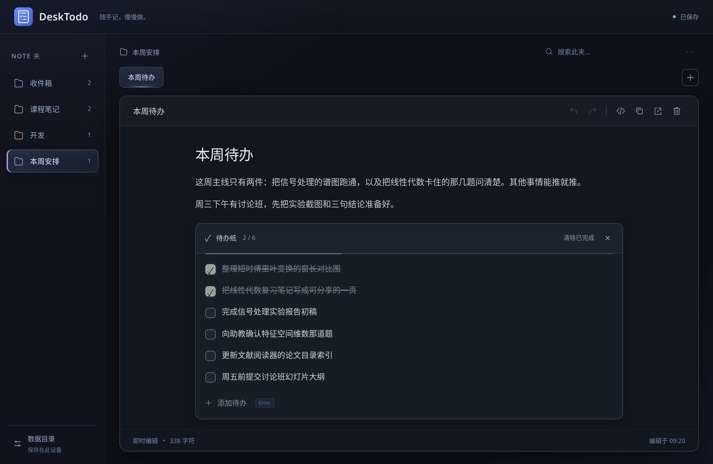
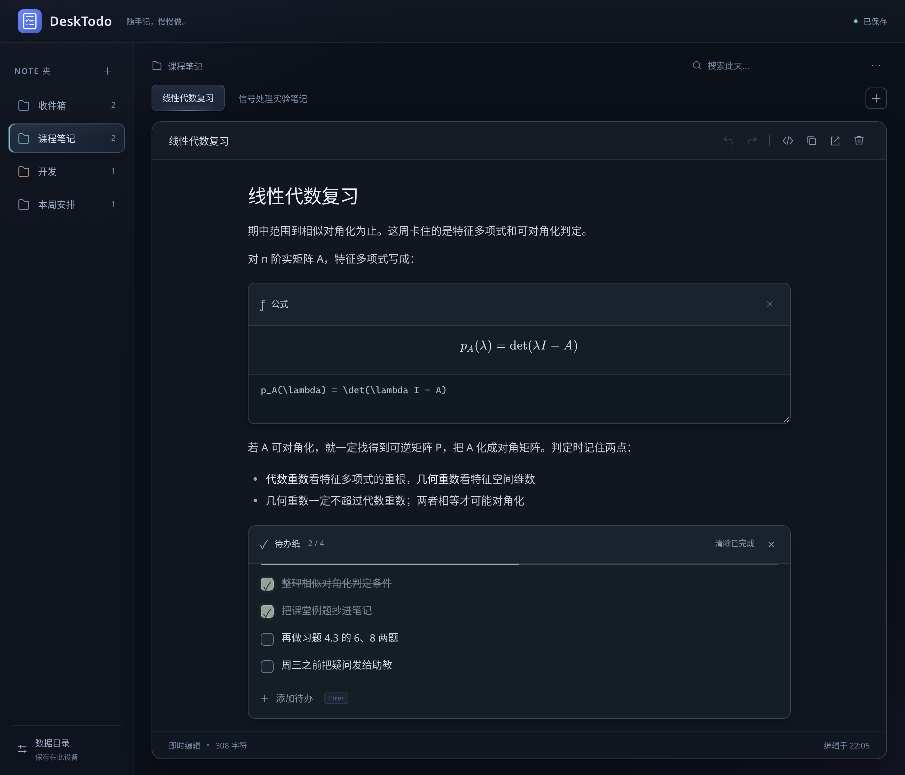
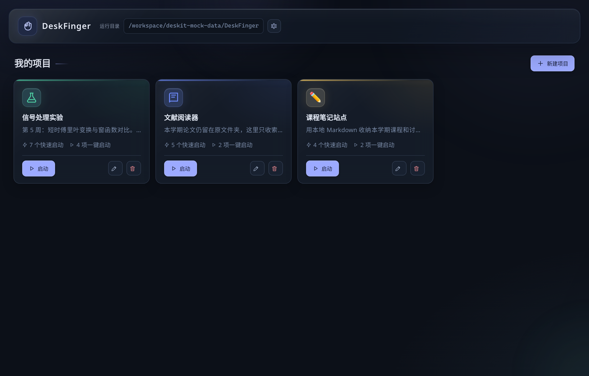
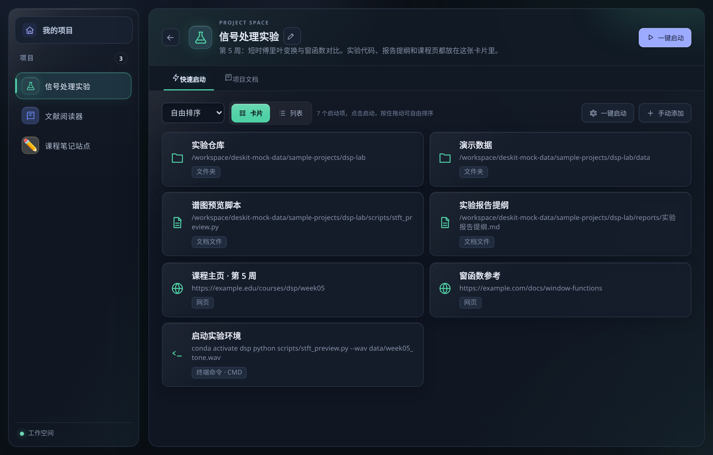
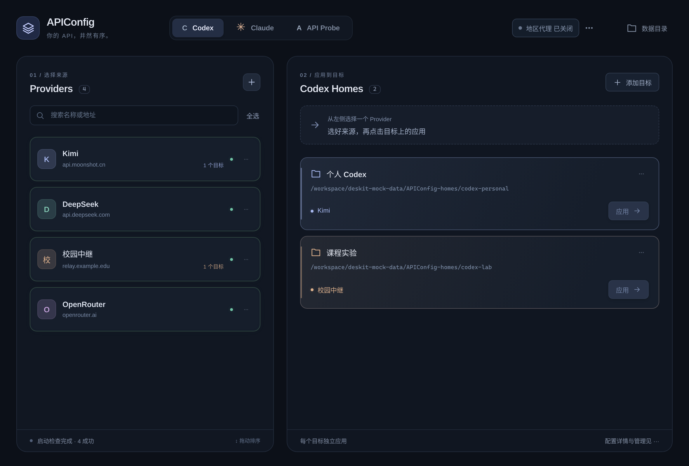
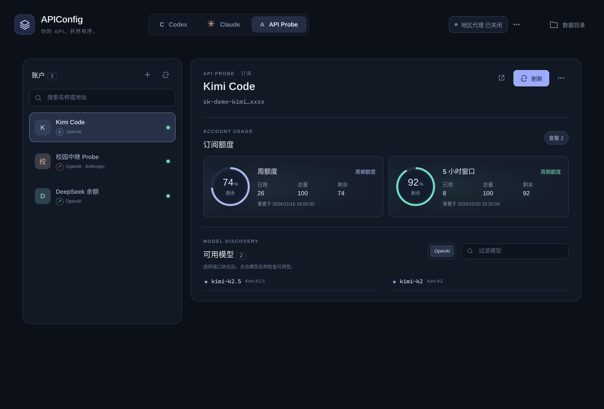
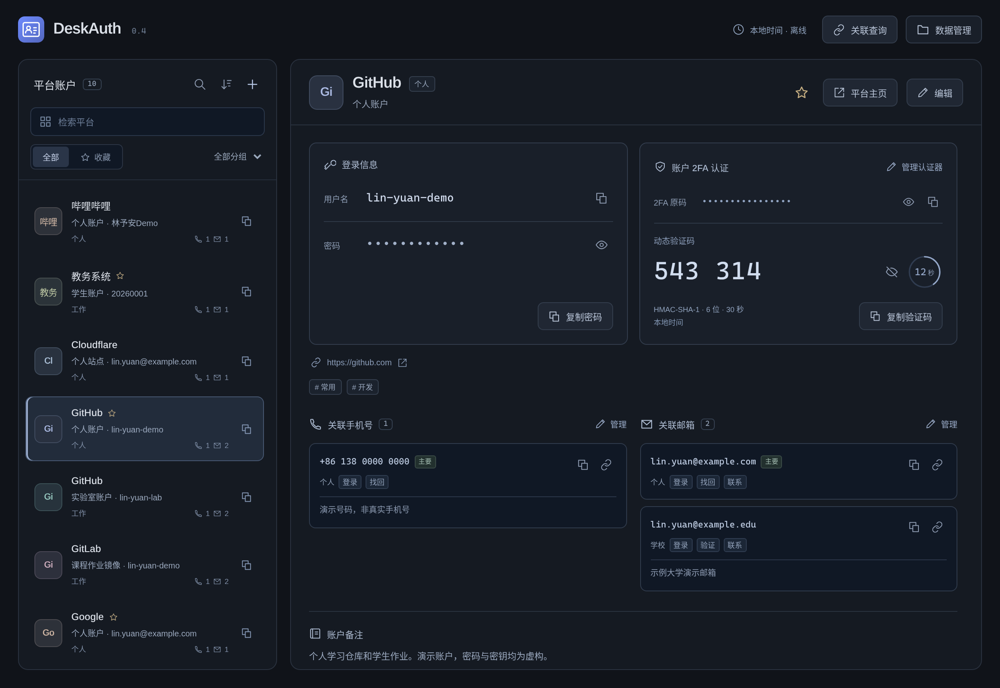
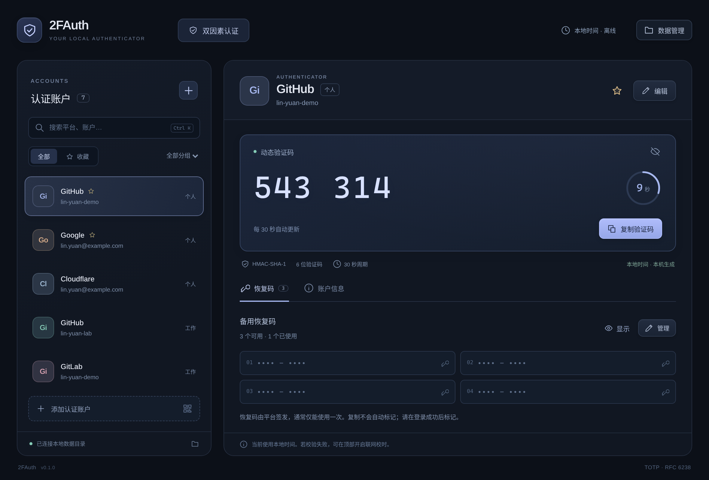

# DeskToolkit：把桌面上反复做的小事收拢起来

日常使用电脑时，很多操作并不复杂，却会在一天里重复很多次：顺手记下一件突然想到的事，重新打开正在做的项目，切换一个 API 地址，翻找某个平台的账号，或是复制一串动态验证码。每件事只花几秒钟，累积起来却总会打断手头的工作。

DeskToolkit 就是为了应对这些零碎时刻而写的。它不是一个包揽全局的工作平台，而是几件各自独立的小工具。每个工具只专注解决一类具体问题，打开即用，数据也直接留在本地电脑里。

## DeskTodo：先把想法放下来

DeskTodo 适合记录那些“现在不记，过一会儿就会忘”的内容。它可以是一条待办、一段学习摘录、几行临时想到的代码，或是一个还没成型的想法。

它的编辑区就像一张可以持续整理的便签。输入标题、列表、引用、代码或表格时，内容会直接渲染成对应的排版；需要写公式或排任务时，可以直接插入公式块与待办清单。清单里的每一项都支持随时修改、勾选、增删，已完成的事项也能一键清理。

当便签逐渐变多，可以用文件夹按主题归档，再通过标签页快速切换。每张便签在底层都是独立的 Markdown 文件，既能在 DeskTodo 中编辑，也能直接用其他编辑器打开。这样笔记不会被锁死在单一应用里，日常备份和迁移目录都很直观。

## DeskFinger：让项目一打开就进入状态

每次开始写代码或推进项目前，往往要先翻找项目目录，再依次打开编辑器、终端、参考网页和几份文档。DeskFinger 处理的就是这种固定却繁琐的准备工作。

在 DeskFinger 里，每个项目对应一张卡片，可以把文件夹、程序、文档、网页链接和终端命令都收拢在里面，也支持直接拖拽添加资源。常用的几个步骤还能串成一个启动流程，比如一键依次打开工作目录、编辑器和终端。

每张项目卡片都附带一份 Markdown 文档，方便顺手记下启动步骤、常用命令、环境说明或当前进度。DeskFinger 只记录资源的路径，不会复制或挪动原有文件，更像一个轻量的项目启动台与备忘录。

## APIConfig：把 API 配置放到看得见的地方

使用 Codex、Claude Code 或各类第三方 API 服务时，填一次地址并不麻烦，麻烦的是时间一长，很难记清各个地址、密钥和配置目录之间的对应关系。

APIConfig 把这些对应关系直观地摆在了同一个界面里。左侧用来整理不同的服务商来源，右侧则显示 Codex 或 Claude 正在使用的配置目录。选中某个来源后，就能直接将它写入对应的工具配置中；需要排查问题时，也可以顺手做一次连接检查、模型列表拉取或额度查询。

如果只是想临时测试某个新 API 能不能连通、支持哪些模型，或者横向对比几家服务，可以直接使用内置的 API Probe。它提供了独立的检测入口，不必先把测试参数写进开发工具的正式配置里。

## DeskAuth 与 2FAuth：把账户资料整理得有迹可循

账户变多之后，让人头疼的往往不只是记不住密码，还有“这个邮箱绑了哪些平台”“哪个号开了两步验证”“同名平台下的两个账号分别用来做什么”。

DeskAuth 把平台名称、用户名、密码、联系方式、备注和 TOTP 验证器整合在同一份档案里。除了常规的搜索、分组和收藏，它还支持通过邮箱或手机号反查关联账户；同一平台下的个人号与工作号，则可以通过别名和备注清楚区分。

2FAuth 则单独把动态验证码这件事拎了出来。它支持手动输入密钥，或是直接导入认证链接与二维码图片。验证码完全在本机计算生成，界面上只保留清晰的倒计时和复制入口，同时支持按组整理账户，以及逐条保存和标记平台恢复码的使用状态。应用内的联网校时功能默认关闭，开启后也仅用于修正内部计算偏差，不会改动系统时间。

这两个工具分工很明确：DeskAuth 负责管理完整的账户档案，2FAuth 专注处理两步验证与恢复码。两者都不需要注册账号，也不做云端同步。

## 共同的底色：看得见的本地文件，顺手的操作

这组工具在数据存储上做了一样的选择——尽量使用通用的本地明文格式。DeskTodo 保存为 Markdown，DeskAuth 和 2FAuth 使用 JSON，APIConfig 直接读写配置文件，DeskFinger 则只存路径索引。每个工具的数据目录都可以自由指定。换电脑时直接拷走文件夹，平时想批量检查也能用普通文本编辑器打开；即便哪天不再使用某个工具，留下的文件依然可以直接接管。

需要注意的一点是，本地保存不等于自动加密。目前 DeskAuth、2FAuth 的 JSON 文件以及 APIConfig 中的密钥均以明文存放在本地磁盘，界面上的密码遮挡仅用于防止旁人窥屏。因此，存放数据的目录和日常备份依然需要保存在可信的设备环境中。

在界面与交互上，它们也保持着相近的习惯：深色背景、安静、少装饰，把高频操作直接放在内容手边。列表支持搜索和排序，数据目录随时可查，误改的内容也能恢复。把它们拆成独立的小工具，也是为了不给人增加学习负担——记笔记只开 DeskTodo，进项目只用 DeskFinger，调接口打开 APIConfig，管账号再找 DeskAuth 与 2FAuth。它们可以单独拿来解决一个小问题，也可以自然地串起日常桌面上的工作流。

---

DeskToolkit 是我在日常学习、开发和整理账户时边用边写的个人项目，主要为了解决自己手头的痛点，代码和思路也公开出来供有相似需求的朋友参考。因为是个人维护的工具，使用前建议先了解它们保存数据的方式，重要资料记得做好本地备份。

注：以上界面截图由 Grok Bot 在助手电脑构建项目后截取，人物身份和数据为虚拟数据。
