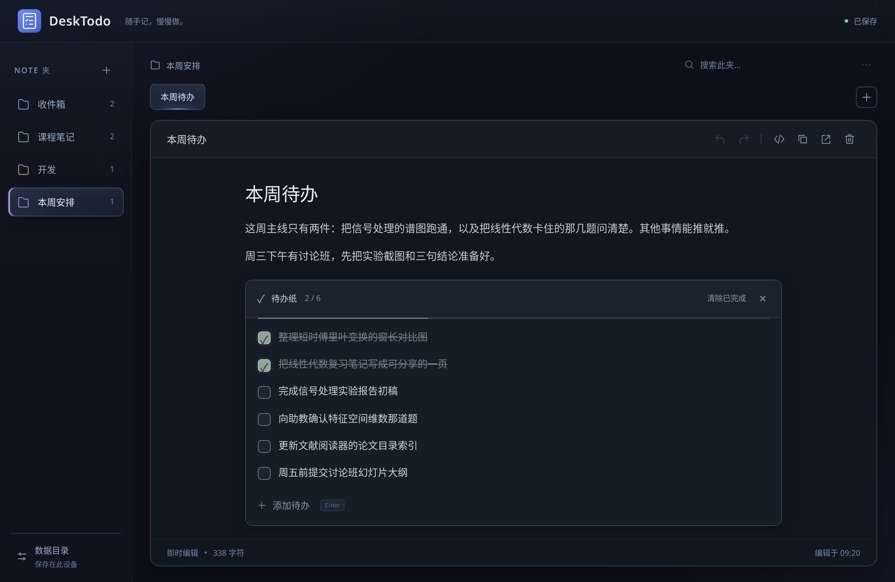
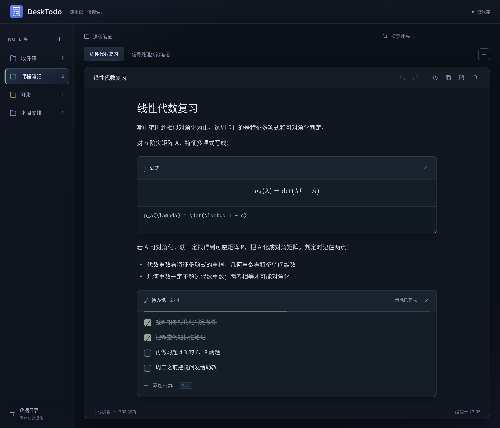
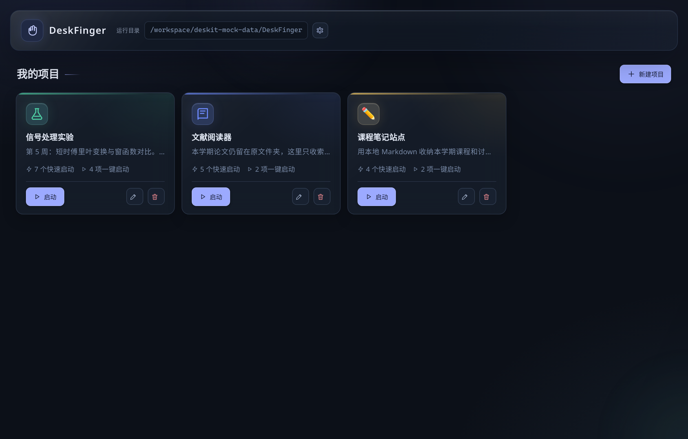
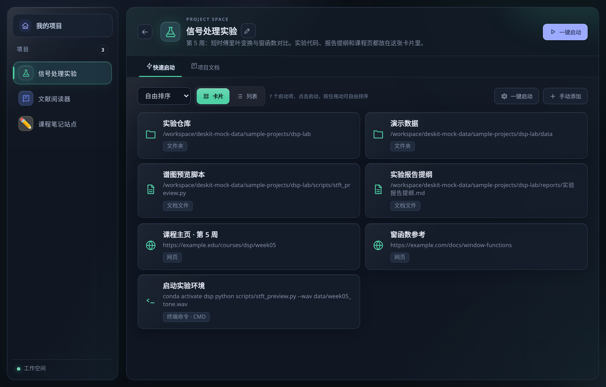
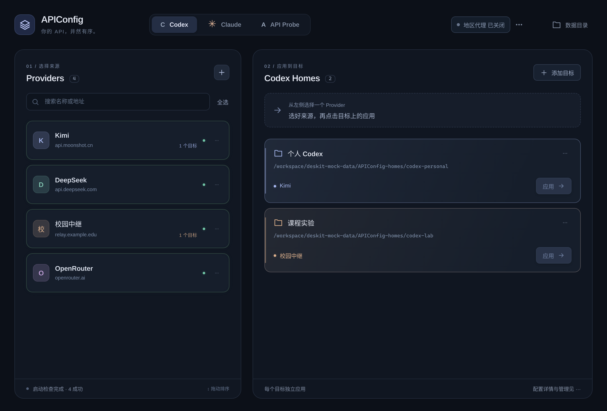
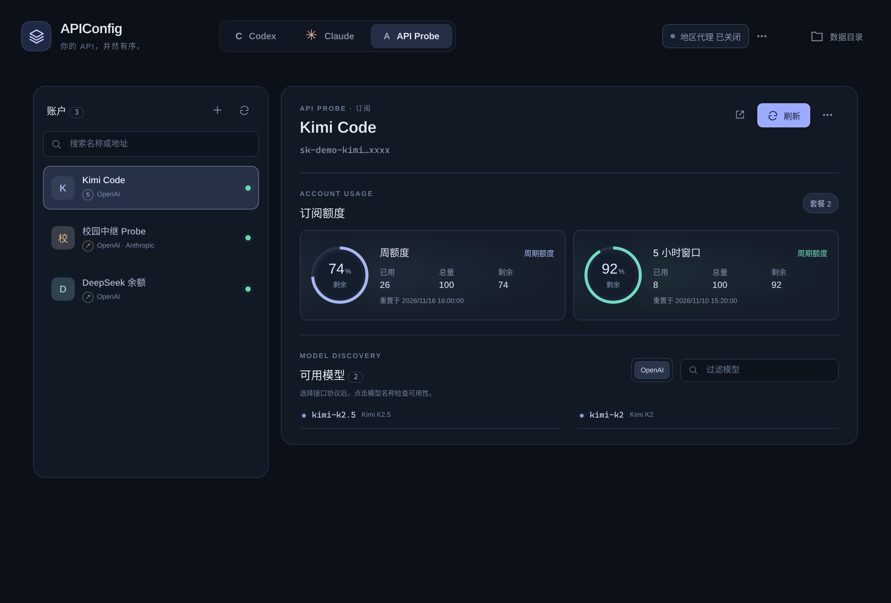
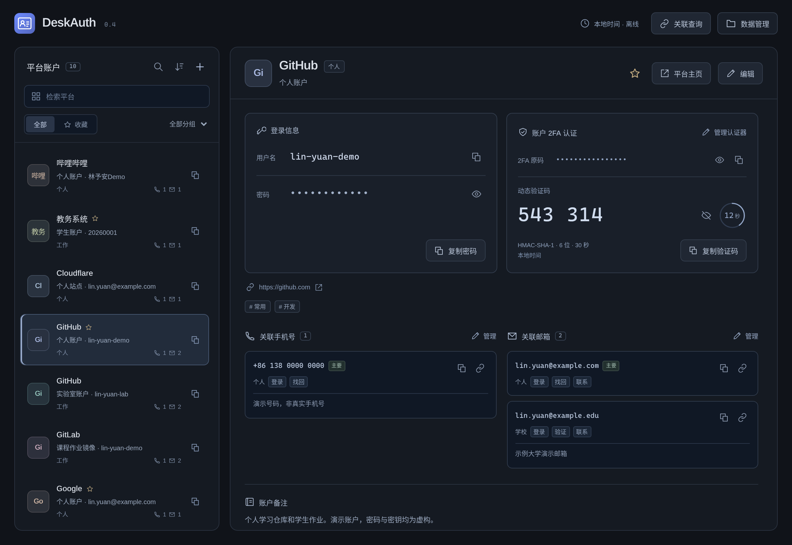

# DeskToolkit: Bringing everyday desktop tasks together

[简体中文](../README-supplyment.md) | English

Many things we do on a computer are simple, but we repeat them throughout the day: jotting down a sudden thought, reopening a project, switching an API address, looking up an account, or copying a verification code. Each takes only a few seconds, yet together they keep interrupting the work at hand.

I built DeskToolkit to help with those small moments. It is a collection of independent tools, each focused on a specific problem, ready when needed, with data stored directly on the local computer.

## DeskTodo: Get the thought down first

DeskTodo is for things you might forget if you do not write them down now: a task, an excerpt from your studies, a few lines of code, or an idea that has not quite taken shape.

Its editor feels like a note you can keep refining. Headings, lists, quotes, code, and tables appear in their formatted form as you type. When you need a formula or a task list, you can insert one directly. Every task can be edited, checked off, added, or removed, and completed items can be cleared with a single action.

As notes accumulate, folders let you organize them by topic and tabs make switching between them quick. Each note is an independent Markdown file, editable in DeskTodo or any other editor that can open it. Your notes remain usable outside the application, and backing them up or moving their directory is straightforward.

## DeskFinger: Get a project ready to work on

Before writing code or getting on with a project, you often have to find its folder, then open an editor, a terminal, reference pages, and a few documents. DeskFinger takes care of this familiar but repetitive preparation.

Each project has a card where you can collect folders, applications, documents, web links, and terminal commands. Resources can also be added by dragging them in. Common steps can be joined into a launch sequence, such as opening the working folder, editor, and terminal in order with one click.

Project cards also include space for Markdown notes, so setup steps, useful commands, environment details, or current progress stay close at hand. DeskFinger records links to external resources without copying or moving the original files. It serves as a lightweight project launcher and a place to keep reminders.

## APIConfig: Make API settings easier to see and manage

When using Codex, Claude Code, or third-party API services, entering an address once is easy. Over time, the harder part is remembering which addresses, keys, and configuration directories belong together.

APIConfig shows those relationships in one place. Service providers are organized on the left, while Codex or Claude configuration directories appear on the right. Select a provider and apply it to the relevant tool's configuration. When something needs checking, you can test the connection, retrieve a model list, or query usage limits.

For a quick check of a new API, a look at its available models, or a comparison between services, the built-in API Probe provides a separate place to do that. You can inspect a service without first writing its settings into a development tool's working configuration.

## DeskAuth and 2FAuth: Keep account details easy to find

As accounts multiply, forgotten passwords are only part of the problem. You may also wonder which services use an email address, which account has two-factor authentication enabled, or what distinguishes two accounts on the same service.

DeskAuth brings the service name, username, password, contact details, notes, and TOTP authenticator into one record. Alongside search, groups, and favorites, it lets you look up related accounts by email address or phone number. Aliases and notes help distinguish personal and work accounts on the same service.

2FAuth focuses on verification codes. You can enter a secret key manually or import an authentication link or QR code image. Codes are calculated entirely on your computer, with a clear countdown and a copy button. You can organize accounts into groups, save recovery codes provided by a service, and mark those codes as used individually. Optional online time calibration is off by default. When enabled, it corrects the time used inside the application without changing the system clock.

The two tools have clear roles: DeskAuth manages complete account records, while 2FAuth concentrates on two-factor authentication and recovery codes. Neither requires you to register an account, and neither syncs to the cloud.

## A shared approach: Visible local files and familiar actions

The tools take a similar approach to storage, using common, readable local formats wherever possible. DeskTodo saves Markdown files; DeskAuth and 2FAuth use JSON; APIConfig reads and writes configuration files; and DeskFinger keeps references to project resources. Each tool lets you choose its data directory. You can copy that folder when moving to another computer or open the files in an ordinary text editor to inspect them. Even if you stop using a tool, its files remain yours to work with.

Local storage does not mean automatic encryption. DeskAuth and 2FAuth currently store their JSON files in plaintext, and APIConfig also keeps its keys in plaintext on the local disk. Password masking on screen only prevents a casual glance from revealing them. The devices and locations where you keep your data and backups therefore still need to be trusted.

The interfaces share familiar habits too: dark backgrounds, restrained decoration, and frequently used actions close to the content. Lists can be searched and sorted, data directories are easy to find, and recovery features help with accidental edits. Keeping the applications separate also keeps them easy to approach: open DeskTodo to take notes, DeskFinger to start a project, APIConfig to manage APIs, and DeskAuth or 2FAuth for accounts and codes. Each can solve a small problem on its own or fit naturally into an everyday desktop routine.

---

DeskToolkit is a personal project I have been building and using while studying, developing software, and organizing accounts. It primarily addresses problems I encounter myself, and I share the code and ideas for others with similar needs. As these are personally maintained tools, take a moment to understand how they store data before using them, and keep local backups of important information.

Note: The screenshots above were captured by Grok Bot after building the projects on the assistant's computer. All identities and data shown are fictional.
