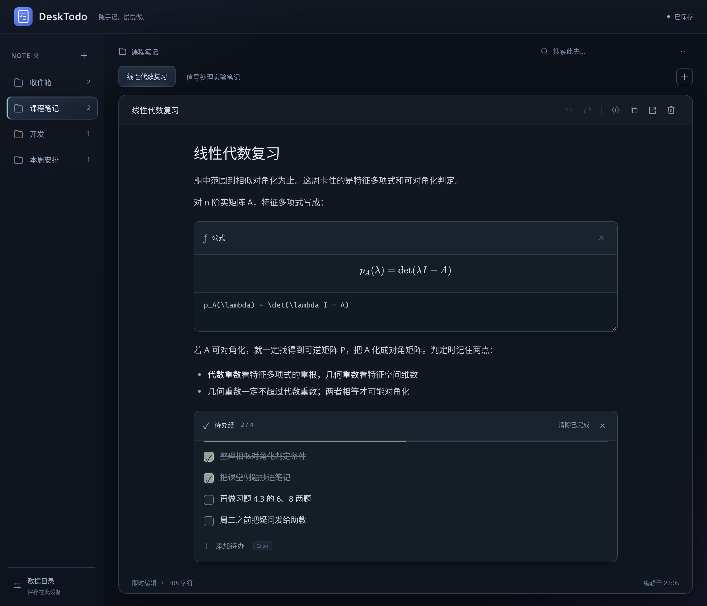
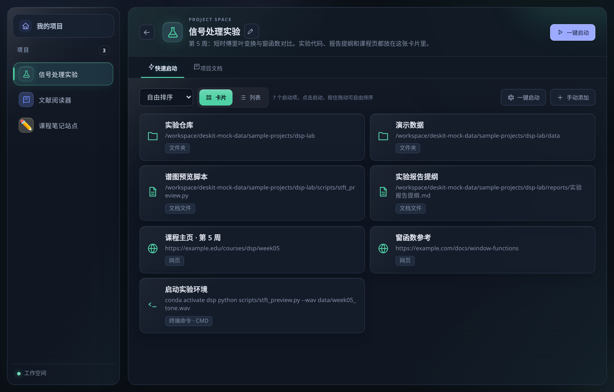
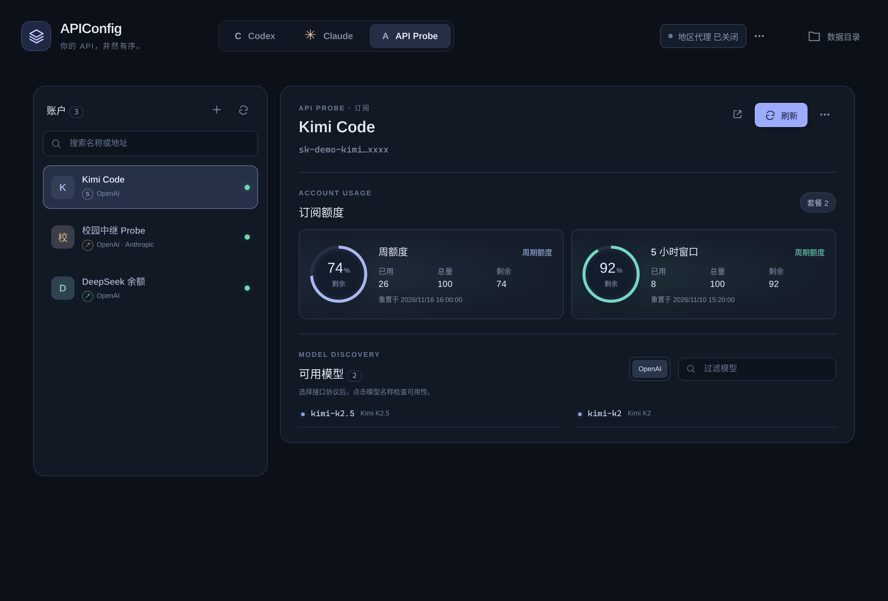
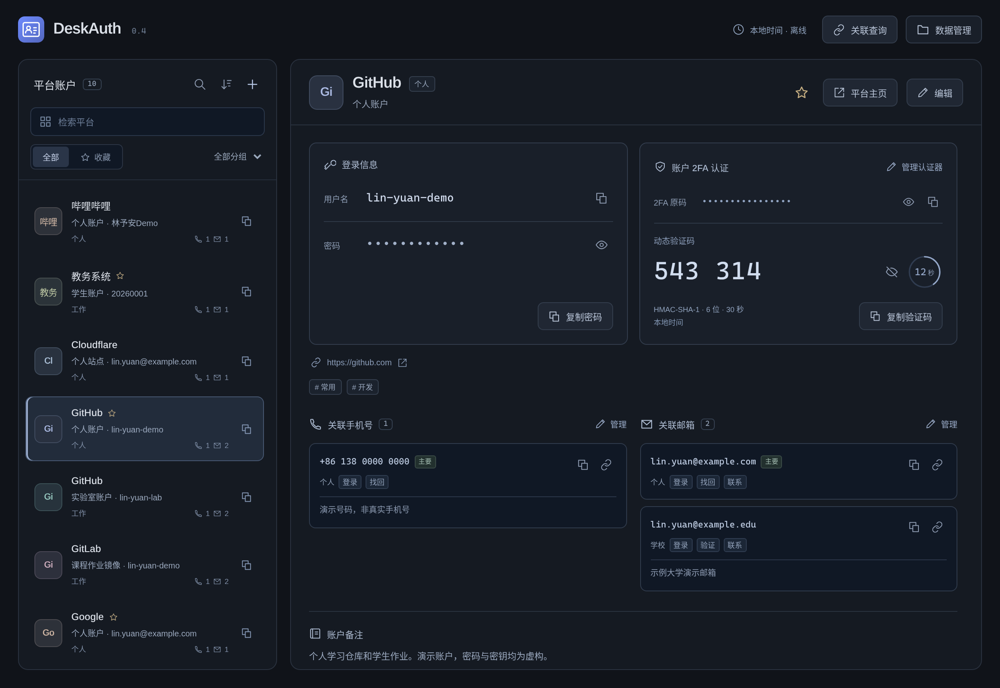

# DeskToolkit

[简体中文](../README.md) | English

A few small tools to make everyday desktop work easier.

DeskToolkit is a collection of Windows desktop tools I have gradually built around studying, development, and account management. Each works independently, but they all address familiar little problems: having nowhere to jot down a thought, opening the same set of things whenever you start a project, keeping track of scattered API addresses and settings, and organizing accounts and verification codes.

The idea is simple: turn repeated searching, copying, and switching into something readily available on the desktop. These tools are meant to be small, quiet helpers with a clear purpose, rather than replacements for larger applications.

For more about the thinking behind the tools and how they fit into everyday use, read the [project introduction](README-supplyment.en.md).

## DeskTodo: Capture a thought, then give it some structure

When an idea comes to mind, you want somewhere you can open and start typing. As your notes grow, you also want to organize them by topic. DeskTodo brings sticky notes, Markdown, and to-do lists together for quick thoughts, study notes, and everyday tasks.

You can edit and format text in the same place, with headings, lists, quotes, code, tables, and mathematical formulas displayed as you type. Tasks can live in a separate “to-do sheet,” where you can check items off, edit their text, add or remove individual rows, and clear completed items in one go. Folders and tabs organize your notes, and each note is saved as its own local Markdown file, ready to open in another editor whenever you need to.

[DeskTodo usage and build instructions (Chinese)](../DeskTodo/README.md)



## DeskFinger: Keep everything a project needs in one place

Starting a project often means opening a folder, an editor, reference pages, and a terminal, then running a few commands. DeskFinger collects these starting points in project cards, reducing the repeated steps needed to get to work.

Each project can include folders, applications, documents, websites, and terminal commands. You can also add resources by dragging them in. Common actions can be combined into a launch sequence—for example, opening the project folder, editor, terminal, and reference material together. A Markdown document area lets you keep setup instructions, useful commands, and project notes alongside those shortcuts. External resources stay where they are; DeskFinger stores their paths without moving the original files.

[DeskFinger usage instructions (Chinese)](../DeskFinger/README.md)



## APIConfig: Manage API services and development tool settings together

When using Codex, Claude Code, or several API services, addresses, keys, and configuration directories can easily end up scattered across different files. APIConfig puts service providers and destination directories together, so you can choose a provider and apply it to the appropriate Codex or Claude configuration.

Alongside switching configurations, it supports connection checks, model discovery, and quota queries. Quota information depends on the interfaces a service offers, and the application distinguishes an unconfigured quota integration from a failed query. A separate API Probe page lets you check APIs using different protocols, view their models, and make a minimal test call when needed, without first adding them to a development tool's configuration.

[APIConfig usage and build instructions (Chinese)](../APIConfig/README.md)



## DeskAuth: Organize accounts and understand how they are connected

One service may have several accounts, while one email address or phone number may be linked to several services. DeskAuth keeps the service, username, password, contact details, notes, and TOTP authenticator together in one account record, making them easier to find and copy.

It supports searching, grouping, and favorites. You can also look up accounts by email address or phone number to see where a contact detail is used. Each account is stored locally in its own JSON file, with support for changing the data directory, creating backups, and keeping records of earlier versions before changes.

[DeskAuth usage and build instructions (Chinese)](../DeskAuth/README.md)



## 2FAuth: A small tool focused on verification codes

If you want to keep your two-factor authentication accounts in one place, 2FAuth provides a straightforward starting point. You can enter a secret key manually or import an authentication link or QR code image. It generates standard time-based one-time passwords (TOTP) locally, with a countdown and a copy button.

Accounts can be grouped and marked as favorites. You can also save recovery codes supplied by a service and mark them as used. No registration is required, and there is no cloud sync. Optional online time calibration corrects the time used to calculate codes; it is off by default and does not change the system clock.

[2FAuth usage and build instructions (Chinese)](../2FAuth/README.md)


## What the tools have in common

They all work with local files. Each project has its own data directory, which you can choose and back up. You can also use other applications to inspect the Markdown, JSON, or configuration files inside. There is no hidden, shared database for the whole collection, and removing one project does not affect another project's data.

The tools also aim to keep important actions visible: you can view and change data directories, search and sort lists, save edits directly, and use reload or recovery options when files change outside the application. Their interfaces share a dark, restrained, lightweight style, intended to fit into the desktop without adding more things to manage.

## Local data and security

These tools do not upload stored data to the cloud by default, but storing something locally does not mean it is encrypted. DeskAuth and 2FAuth currently use plaintext JSON, with no master password or disk encryption provided by the applications. APIConfig also stores API keys in local configuration files. Keep data directories, backups, and exported files in a trusted location. Masking a password on screen only hides the text from view; it does not encrypt it.

## Development and builds

The projects use Tauri, React, TypeScript, and Rust. Development and release builds on Windows require Node.js, pnpm or npm, the stable Rust MSVC toolchain, Visual Studio C++ build tools, and the WebView2 Runtime. Each project has its own dependencies, data directory, and build process.

| Project | Development port | Install dependencies |
| --- | ---: | --- |
| APIConfig | 1430 | `pnpm install --frozen-lockfile` |
| DeskFinger | 1431 | `npm ci` |
| 2FAuth | 1432 | `pnpm install --frozen-lockfile` |
| DeskAuth | 1433 | `pnpm install --frozen-lockfile` |
| DeskTodo | 1442 | `pnpm install --frozen-lockfile` |

Using DeskTodo as an example:

```powershell
cd DeskTodo
pnpm install --frozen-lockfile
pnpm tauri dev
```

To build the Windows application and installer, run this in the relevant project directory:

```powershell
pnpm tauri build
```

For DeskFinger, if you installed dependencies with npm, use `npm run tauri -- build`. If PowerShell blocks `pnpm.ps1`, use `pnpm.cmd` instead. Build outputs are stored in the project's `src-tauri/target/release/` directory, with installers under `src-tauri/target/release/bundle/`. Dependency caches in `target` can be cleared; keep the `.exe` files and installers you intend to distribute.

GitHub Actions runs a combination of frontend builds, interaction tests, Rust formatting checks, and Rust tests for the configured projects. See [.github/workflows/ci.yml](../.github/workflows/ci.yml) for the exact checks. APIConfig's Rust query tests use local mock servers and do not connect to real providers. The [APIConfig README (Chinese)](../APIConfig/README.md) also explains the Windows socket handling used by these tests.

## About DeskToolkit

These tools grew out of ongoing personal experimentation and vibe coding. They primarily serve my own study, development, and everyday organizational needs, and I hope they can offer useful ideas to others with similar problems. They make no promise of production-grade reliability, general suitability, or security. Please decide whether they fit your needs and the risks you are comfortable with.

Project repository: [GitHub · DeskToolkit](https://github.com/Graygoo7529/DeskToolkit)

The interface screenshots were captured by Grok Bot after building the projects on the assistant's computer. All identities and data shown are fictional.
